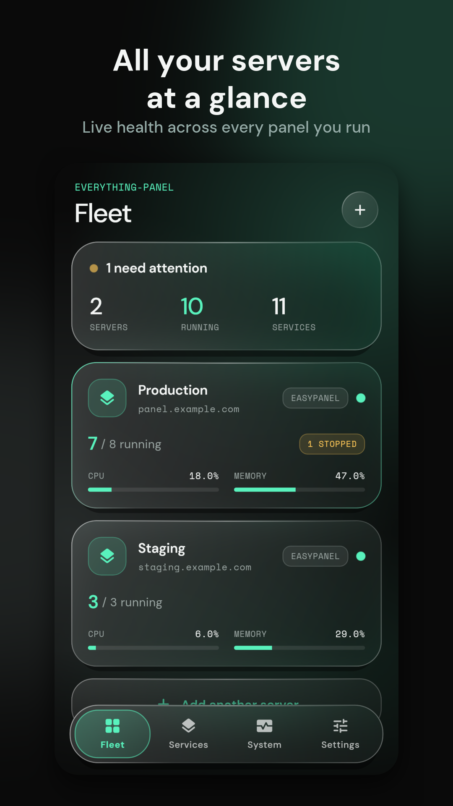
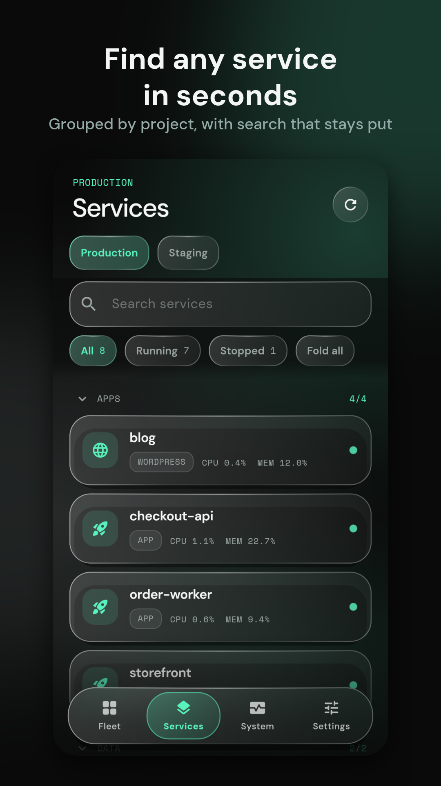
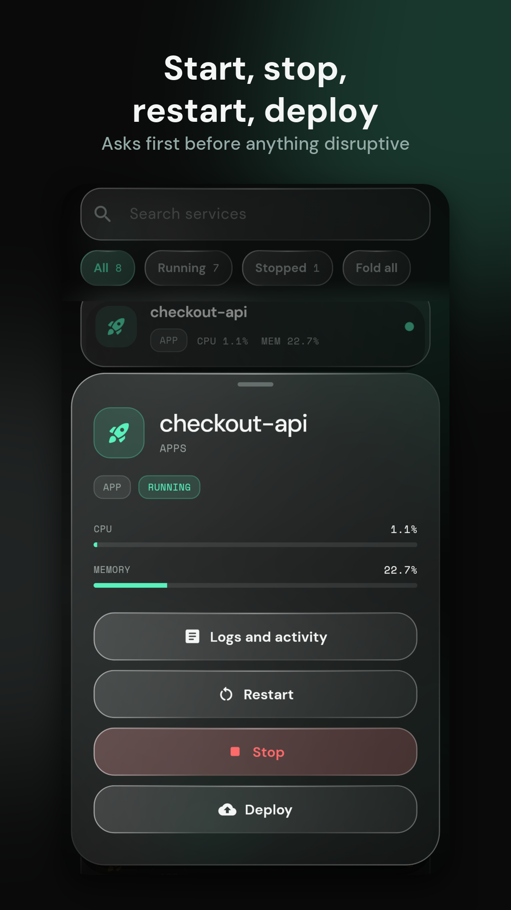
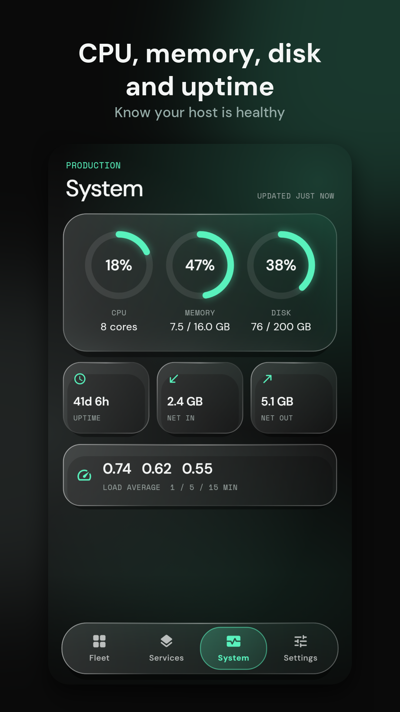

# everything-panel: features

One glass control panel for every server provider. Easypanel today; the provider layer is built so
Coolify, Dokploy, Portainer and CapRover can follow.

All screenshots below use made-up demo data. No real server appears in them.

  

  
  
  
  

## Your fleet

- **Several servers at once.** Add as many panels as you like and see them side by side. Each card
  shows how many services are running and the host's live CPU and memory.
- **Provider-ready.** Servers are saved against a provider. Easypanel ships first; adding another
  provider is one backend class plus one entry in `lib/data/providers.dart`.
- **Connect with an API token or with email and password.** The password is used once to get a
  token and is never stored.

## Services

- **Grouped by project, foldable.** Tap a project header to fold or unfold it, or use *Fold all*.
  A search shows every match even inside a folded group.
- **Search and filters that stay put.** The search field and the All / Running / Stopped chips are
  pinned while the list scrolls under a frosted bar.
- **Live status.** A pulsing light per service, with CPU and memory for anything running.
- **Control.** Start, stop, restart and deploy apps and stacks; start, stop and restart boxes and
  WordPress sites. Anything that interrupts a service asks first. Databases are view-only because
  Easypanel offers no start or stop for them.
- **Activity and logs.** Every service has its recorded builds, deployments, starts and stops, each
  with its full log text. Runtime logs appear when the panel has log aggregation turned on, and the
  app tells you when it is off.

## System

- CPU, memory and disk as live gauges; uptime, load average and network totals; one place per server.

## Alerts

- **Service-down alerts** while the app is open: you are told when something you were watching stops
  running. A service you stopped yourself does not alert.
- Push notifications (Firebase Cloud Messaging) can be received once a sender exists.

## Private by design

- **No account needed.** Servers and tokens stay on the device; tokens live in the Android keystore.
- **Optional Google sign-in and end-to-end encrypted sync.** Sign in, choose a passphrase, and your
  servers follow you across devices. The key is derived on the device (PBKDF2-HMAC-SHA256, 310 000
  rounds) and entries are sealed with AES-256-GCM before they leave it, bound to your account and the
  entry id. Firestore only ever stores ciphertext, behind rules that let you touch only your own
  documents. Forget the passphrase and nobody can recover the cloud copy; delete it and start over
  any time from Settings.
- Free tier throughout: no billing account is attached to the Firebase project.

## Design

- **Liquid glass** surfaces with specular edges, spring motion and interruptible gestures; reduced
  motion and high contrast are respected.
- **Phone and tablet.** A floating bottom bar on phones, a side rail and centred content on tablets;
  server cards pair up on wide windows.
- Dark and light themes, following the system.

## Under the hood

- Flutter, Android first. Screen-level end-to-end tests drive the real screens against a fake panel
  at phone and tablet sizes; CI runs analysis and every test on each push.
- Signed APK and Play Store bundle (AAB) on every tagged release, and a rolling nightly from `master`.
- Source is MIT-licensed; the credentials used for official builds are not in the repository.

## Roadmap

- More providers: Coolify, Dokploy, Portainer, CapRover.
- Background alerts and a small sender for push notifications.
- iOS.
